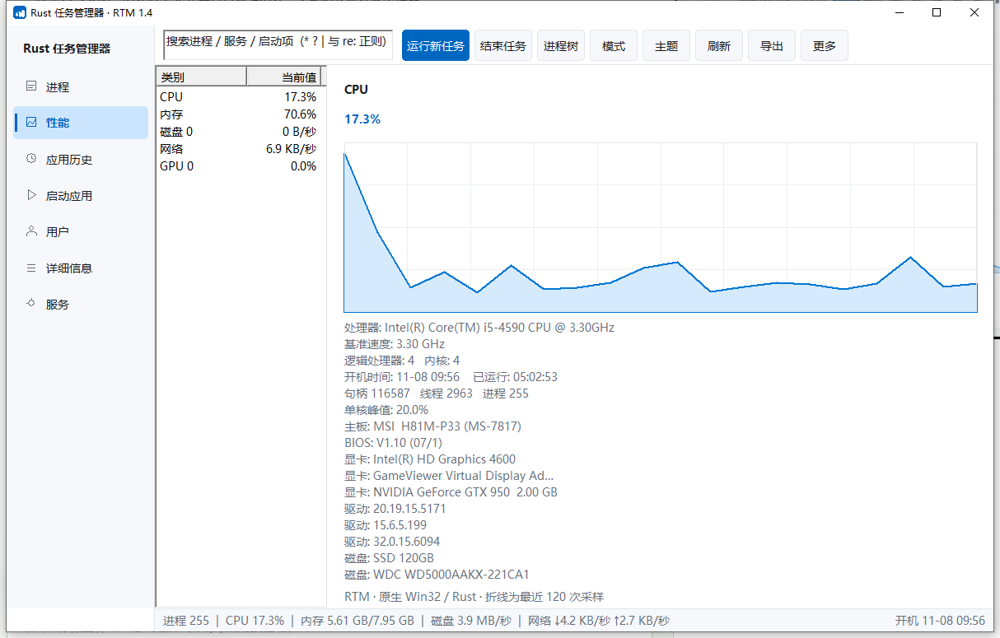

# RTM · Rust Task Manager

原生 Win32 实现的 Windows 任务管理器，Rust 编写，无任何运行时依赖。



## 特性

- **进程页**：每行程序图标、进程树（可折叠）、应用/后台分组、CPU 趋势箭头、排序、正则搜索、右键菜单（结束任务/结束进程树/打开文件位置/复制命令行/属性）
- **性能页**：CPU / 内存 / 磁盘 / 网络 / GPU 五张实时曲线，附硬件清单（主板、BIOS、显卡与驱动版本、磁盘型号与 SSD/HDD 判定、物理内存）
- **启动应用页**：注册表与启动文件夹枚举，带**启动时间**与**启动影响（估算）**两列
- **其它页**：用户会话、详细信息、服务、应用历史
- **外观**：浅色 / 深色 / 跟随系统三档主题，进程树与经典双模式界面，窗口尺寸自适应，托盘驻留
- **其它**：全局快捷键 `Ctrl+Alt+T`、正则搜索、CSV 导出、批量结束任务、自定义刷新间隔

## 数据来源

`NtQuerySystemInformation`（进程与句柄）、PDH（CPU/内存/磁盘/网络）、`GPU Engine` 性能计数器（显卡）、服务控制管理器、`EnumProcessModules` + `FileVersionInfo`（签名与版本）、`WTS`（会话）、IP Helper（网络连接）、注册表（启动项、硬件清单）、SMBIOS（内存条）。

## 构建

需要 Rust stable（GNU 目标）与 Python 3（仅用于图标注入）。

```bash
cargo build --release
python mkicon.py        # 把 rtm.ico 以资源形式注入可执行文件
```

产物：`target/release/rtm.exe`，单文件约 730 KB，常驻内存约 26 MB。

## 打包

```bash
cp target/release/rtm.exe dist/
cp install.bat uninstall.bat dist/
iexpress /N setup.sed   # 生成 dist/RTM-Setup.exe
```

`setup.sed` 使用相对路径，可在任意机器上打包。

## 安装

运行 `RTM-Setup.exe`：

1. 程序安装到 `%LOCALAPPDATA%\Programs\RTM`，并创建桌面与开始菜单快捷方式
2. 安装器会询问是否**接管系统任务管理器**。选 `Y` 后写入注册表

   ```
   HKLM\SOFTWARE\Microsoft\Windows NT\CurrentVersion\
       Image File Execution Options\Taskmgr.exe\Debugger
   ```

   之后 `Ctrl+Shift+Esc`、任务栏右键菜单、`Ctrl+Alt+Del` 都会启动 RTM。运行安装目录下的 `uninstall.bat` 可完全恢复原版。

接管操作需要管理员权限，安装器会自动请求提升。

## 已知限制

- CPU 列目前是趋势箭头，行内迷你折线需要把列表控件换成完全自绘实现
- 「启动影响」是基于当前累计 CPU/磁盘/内存的**估算**，并非系统原始评分
- 部分系统的 SMBIOS 内存条明细可能取不到

## 许可

MIT
